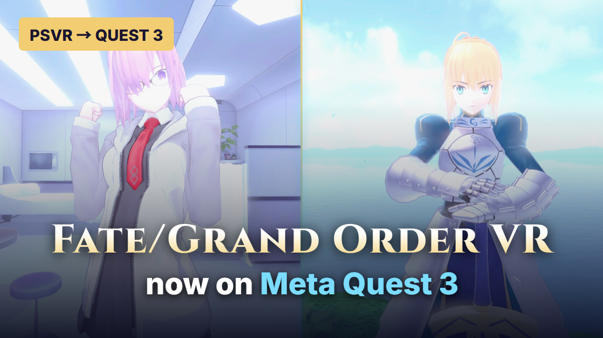

# FGO VR — PCVR 0.2.2 / Quest 3 0.2.0

[English](README.md) | [日本語](README.ja.md) | [简体中文](README.zh-CN.md) | [Français](README.fr.md) | [Deutsch](README.de.md) | [Español](README.es.md) | [Português](README.pt.md) | [Italiano](README.it.md)

Juega a **Fate/Grand Order VR feat. Mash Kyrielight** con una compilación de compatibilidad basada en AstroQuest/shadPS4. El proyecto está dirigido al título japonés de PS4 **CUSA09078**, versiones del juego **01.00 / 01.01**.

- **PCVR:** OpenXR mediante Virtual Desktop y VDXR (Launch-PCVR.cmd) o SteamVR de forma opcional (Launch-PCVR-SteamVR.cmd).
- **Quest 3 independiente:** núcleo ARM64 local con FEX y Turnip; el PC no transmite los fotogramas del juego.

Este proyecto y sus descargas son públicos. [Ver el video de demostración](https://saberwatchmanga.github.io/FGO-VR/?lang=es). Los paquetes no incluyen datos del juego de PS4, PKG, firmware, claves ni partidas guardadas. Debes proporcionar tu propio juego extraído.

## Video de demostración

[](https://saberwatchmanga.github.io/FGO-VR/?lang=es)

**[▶ Ver la demostración](https://saberwatchmanga.github.io/FGO-VR/?lang=es)** · [Ver en YouTube](https://youtu.be/zBSpUSqpUaw)

## Descargas

La carpeta portátil completa para Windows, el APK de Quest y el código fuente están en la [publicación v0.2.2](https://github.com/saberwatchmanga/FGO-VR/releases/tag/v0.2.2):

| Archivo | Componente |
| --- | --- |
| [FGO-VR-0.2.2-PCVR-Windows.zip](https://github.com/saberwatchmanga/FGO-VR/releases/download/v0.2.2/FGO-VR-0.2.2-PCVR-Windows.zip) | Compilación PCVR para Windows y ajustes externos de resolución |
| [FGO-VR-0.2.0-Quest3.apk](https://github.com/saberwatchmanga/FGO-VR/releases/download/v0.2.2/FGO-VR-0.2.0-Quest3.apk) | Compilación independiente para Quest 3, sin cambios en esta actualización para PC |
| [FGO-VR-0.2.2-Source.zip](https://github.com/saberwatchmanga/FGO-VR/releases/download/v0.2.2/FGO-VR-0.2.2-Source.zip) | Parches fijados, instantáneas del código fuente modificado, referencias de compilación y licencias |
| `SHA256SUMS` / `artifact-manifest.json` | Verificación de archivos y versiones de los componentes |

## Inicio rápido en Windows / PCVR

Requisitos: Windows de 64 bits, GPU y controlador compatibles con Vulkan, y runtime de Microsoft Visual C++. VDXR requiere Virtual Desktop Streamer en el PC y Virtual Desktop en el visor. La ruta opcional de SteamVR requiere Steam con SteamVR y un visor compatible; Quest 3 debe conectarse primero a SteamVR mediante Steam Link. Esta ruta no requiere Virtual Desktop.

1. Extrae `FGO-VR-0.2.2-PCVR-Windows.zip`.
2. Coloca el juego base extraído, incluido `eboot.bin`, en `FGO-PC/games/CUSA09078`. Coloca la actualización opcional junto a él, en `FGO-PC/games/CUSA09078-UPDATE`. La actualización no puede ejecutarse sin el juego base.
3. Para VDXR, conecta el visor mediante Virtual Desktop y deja Streamer en funcionamiento.
4. Haz doble clic en **`Launch-PCVR.cmd`**. El lanzador selecciona VDXR para este proceso sin cambiar el ajuste OpenXR del sistema. Cierra la ventana del juego para salir.
5. Para cambiar la resolución, abre **`Resolution-Settings.cmd`**. Requiere Python 3 con Tk. Guarda el ajuste y reinicia el juego. Si no tienes Python, edita `FGO-Resolution/settings.json` o usa un lanzador directo dentro de `profiles`.
6. **`Launch-PCVR-Original.cmd`** siempre usa la compilación con resolución original y las mismas partidas guardadas.

También se conservan los lanzadores originales con nombres en chino. Las fuentes del sistema opcionales siguen las instrucciones de AstroQuest upstream; no se incluyen archivos del sistema de la consola.

Ubicación de las partidas guardadas: `FGO-PC/runtime-vr/user/home/1000/savedata/CUSA09078`. Cierra el juego antes de hacer una copia de seguridad de todo el directorio del título.

### Ruta opcional de SteamVR

Inicia Steam y SteamVR manualmente. En Quest 3, conecta primero el visor a SteamVR mediante Steam Link y después ejecuta Launch-PCVR-SteamVR.cmd (también disponible como 启动FGO-VR-PCVR-SteamVR.cmd). SteamVR ya debe estar en ejecución; el lanzador no lo inicia automáticamente. Selecciona el manifiesto del runtime de SteamVR solo para este proceso del juego y no cambia el valor predeterminado global de OpenXR. Ambos lanzadores usan el mismo núcleo, las mismas partidas guardadas y el mismo ajuste de resolución. El argumento original -RenderScale 100 sigue siendo compatible. Esta ruta no requiere Virtual Desktop.

El 18 de octubre de 2026, el usuario confirmó un inicio de Quest 3 mediante Steam Link con resolución interna del 150 %; la sesión duró unos 52 segundos y terminó normalmente (código de salida 0). Fue solo una prueba breve de inicio, no una partida completa de SteamVR ni una evaluación detallada de FPS, audio o comodidad.

Consulta la [guía de SteamVR](docs/STEAMVR.md) para más detalles.

## Inicio rápido en Quest 3 independiente

Instala `FGO-VR-0.2.0-Quest3.apk` (paquete `com.fgovr.quest`, código de versión 2). Una actualización con la misma firma puede conservar los datos de la aplicación. Activa la depuración USB y copia las carpetas del juego extraído en:

```text
/data/local/tmp/fgovr/games/CUSA09078
/data/local/tmp/fgovr/games/CUSA09078-UPDATE
```

La segunda ruta corresponde solo a la actualización opcional 1.01.

Comprueba que los archivos se puedan leer. Consulta [instalación en Quest](docs/INSTALL_QUEST.md) para ver los comandos y los detalles de actualización.

Con un solo Quest conectado por USB, usa la herramienta de configuración de Windows para enviar al Quest el ajuste de resolución y luego cierra y reinicia la aplicación. La herramienta crea una copia de seguridad de la configuración actual y solo cambia `fgo_render_scale`.

Los registros y ajustes están en `/sdcard/Android/data/com.fgovr.quest/files/`. `vrhost.txt` acepta `fgo_render_scale=100/110/125`. Una vez iniciada, la aplicación ejecuta el juego localmente en el visor.

## Perfiles de resolución

Ambos componentes usan **100 / OFF** de forma predeterminada: equivale a 100% / 1.00x y conserva la resolución original. Los valores más altos aumentan el uso de GPU y memoria. Estos son perfiles de renderizado internos del juego; el porcentaje de resolución que muestra VDXR es una medición aparte.

| Perfil | PCVR | Quest 3 | Resultado observado |
| --- | --- | --- | --- |
| 100 | Resolución original | Resolución original | Un usuario de Quest informó de aliasing intenso |
| 110 | Disponible | Disponible | Un usuario de Quest lo consideró aceptable, aunque con aliasing visible |
| 125 | Solo se comprobó el inicio | Disponible | Un usuario de Quest informó de tirones notables |
| 150 | Disponible | Solo PC | Un usuario de PCVR/VDXR informó de buena calidad de imagen y confirmó haber completado el juego entero |

**110** es el perfil inicial recomendado para Quest. El metraje de Quest del video de vista previa se capturó en modo independiente a 100 (1.00x); el aliasing se nota más que en PC. Si tienes un PC para juegos, es preferible transmitir PCVR mediante Virtual Desktop. Si el rendimiento es bajo, vuelve a 100. El PC probado tenía un i5-13400F / RTX 4070 / 64 GB de RAM; no se afirman cifras cuantitativas de FPS ni rendimiento comprobado durante toda la historia.

Los objetivos verificados por ojo son 1408×1512 en 100, 1536×1663 en 110, 1792×1890 en 125 y 2048×2268 en PC150. El parche sustituye la solicitud canónica verificada del juego de 1.4f, conserva las demás solicitudes y comprobaciones de asignación, y evita multiplicar la escala repetidamente.

### Corrección de transiciones en PCVR 0.2.1

Con una resolución mayor, una transición de la historia agotaba antes el conjunto fijo de memoria gráfica del juego. Después, un mensaje de falta de memoria mal formado provocaba un segundo cierre inesperado. PCVR 0.2.1 aumenta a la vez el conjunto gráfico y el presupuesto local del proceso asociado de memoria Backing/Direct, y corrige el formato del mensaje. El presupuesto adicional no se guarda en la configuración.

El **7 de octubre de 2026**, el usuario confirmó que **completó el juego entero en PCVR / VDXR a 1.50x**. La transición que antes provocaba el cierre también superó la nueva prueba y la sesión grabada terminó normalmente. También pasaron las comprobaciones de inicio PC125/150 y la reversión a 100. El APK y el código fuente de Quest siguen en 0.2.0; esta corrección para PC no se ha aplicado a Quest.

El SHA-256 del núcleo aceptado es `563be6008f73855c3b4425c93bca104692999e97f0fb16cf956c5d3aa40123c1`.

Consulta los [detalles de las pruebas](TESTING.md) y el [registro de aceptación del usuario](docs/USER_ACCEPTANCE_20261007.md).

- Una sesión PC150 posterior terminó con una infracción de acceso durante la precarga de Unity. La causa sigue sin determinarse; consulta los [detalles de las pruebas](TESTING.md).

## Controles

| Entrada | Asignación |
| --- | --- |
| Left Touch stick | Direcciones del menú |
| Left / right grip | L1 / R1 |
| Left / right trigger | L2 / R2 |
| Right A | Cross / confirmar |
| Clic simultáneo de ambos sticks | Recentrar |
| Keyboard Q / E | Confirmar |
| Keyboard arrows | Selección del menú |

La pose de apuntado de la mano derecha se conecta al seguimiento DualShock normal del juego. Los controles básicos funcionan. No se han validado el comportamiento completo de Move, el apuntado preciso ni todas las interacciones de entrenamiento.

## Límites actuales

- Quest125 presenta tirones en el visor del usuario; Quest110 todavía muestra aliasing.
- **PCVR / VDXR 1.50x: el usuario confirmó haber completado el juego entero.** En esta ronda de reparación, PC125 solo se comprobó al iniciar.
- No se han evaluado por separado la estabilidad de ejecuciones repetidas, los FPS medidos en el visor ni la comodidad en otro hardware.
- Aún hay limitaciones en las capas adicionales de reproyección, la compatibilidad completa con Move y algunas interfaces de seguimiento.
- Esta compilación está dirigida a FGO VR. Los demás juegos de PSVR requieren sus propias comprobaciones de compatibilidad.

## Código fuente, compilaciones y créditos

Basado en [AstroQuest](https://github.com/bigmak94/AstroQuest), fijado al commit `9f42c44d4e838e3a0df67913e350c4f098110862`, y en [shadPS4](https://github.com/shadps4-emu/shadPS4).

Los parches completos por plataforma están en `patches`; los archivos modificados están en `source_snapshot`. **Aplica un único parche completo para la plataforma elegida. No apiles encima parches de fases anteriores.**

`tools/prepare_source.py` obtiene el código fuente upstream fijado y aplica el parche de la plataforma seleccionada. Consulta las [instrucciones de compilación](docs/BUILD.md) para ver las entradas fijadas y los scripts de referencia. Puede ser necesario ajustar algunas rutas de desarrollador; no se afirma que la compilación funcione con un solo clic en una máquina limpia. No se incluyen claves de firma de la release.

Se conservan los avisos del código fuente bajo GPL-2.0-or-later y las licencias de terceros aplicables. Consulta [LICENSE](LICENSE), [THIRD-PARTY-NOTICES.md](THIRD-PARTY-NOTICES.md) y los avisos upstream. Este es un proyecto de compatibilidad no oficial; el juego original y sus personajes pertenecen a sus respectivos titulares de derechos.

## Apoyo

Si este proyecto te resulta útil, puedes apoyar su desarrollo continuo en [Ko-fi / terry2418](https://ko-fi.com/terry2418). Gracias por tu apoyo.
